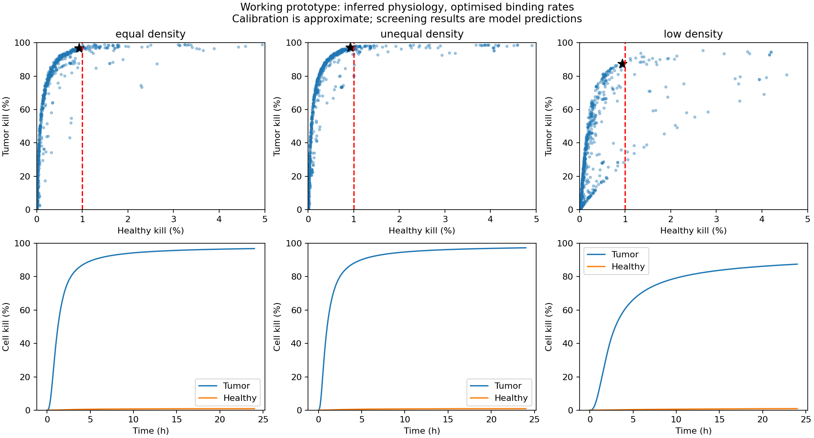

# In silico modelling of therapeutic bispecific antibodies

An executable PK/receptor-occupancy model and optimisation prototype based on Stoddard et al., **“Model-optimized bispecific antibodies improve the selectivity of antibody–drug conjugates for tumors”** ([2026 paper and supplementary material](https://doi.org/10.20935/AcadDrug8407)).

**Status:** working, inference-led computational prototype. We reconstructed the reported mechanisms, inferred two missing physiological inputs from approximate figure readings, and identified binding-rate combinations with high predicted tumour kill and low predicted healthy-cell kill. This is **not an exact reproduction, an experimentally validated antibody design, or a demonstrated global optimum**.

## Start here

- **[Results and comparison with the paper — PDF](output/prototype/prototype_addendum.pdf)** ([LaTeX source](output/prototype/prototype_addendum.tex)): current results, inferred assumptions, numerical verification and remaining discrepancies.
- **[Detailed implementation report](output/prototype/PROTOTYPE_REPORT.md)**: workflow, selected rates and sensitivity findings.
- **[Model analysis — PDF](output/model_analysis.pdf)** ([LaTeX source](output/model_analysis.tex)): definitions, assumptions, parameter provenance, full reconstructed ODEs, cell-kill equations and optimisation formulation. This records the earlier reconstruction; the addendum gives subsequent results.



## What is implemented

- A **27-state ODE system** coupling two-compartment free-ADC PK to four target-expressing cell populations: tumour, healthy T1-only, healthy T2-only and healthy dual-positive.
- Sequential 3D first-arm binding, 2D second-arm binding/avidity, receptor synthesis and turnover, and cumulative ADC internalisation. The default surface dissociation convention follows the Sengers microscopic-reversibility relation; an alternative is selectable.
- A bivalent monospecific comparator with identical-arm/bond statistical factors.
- Population-specific Emax killing, `A / (EC50 + A)`, followed by healthy-population weighting. Intracellular means over **all** healthy cells and **target-positive** healthy cells are exported separately.
- Four published-rate trajectory scenarios, seven parameter-sweep families covering Figures 5–7 and S1–S4, and unequal-/low-density screening corresponding to the Figure 8/S5 questions.
- Four-rate log-space optimisation with Platypus NSGA-II, uncertainty sensitivity checks, numerical verification, and CSV/JSON/PNG outputs.

The current search minimises `(-tumour kill, healthy kill)` with **healthy kill ≤0.95%** at 24 h, providing nominal headroom below 1%. It explores `kon = 10²–10⁷ M⁻¹s⁻¹` and `koff = 10⁻⁵–10² s⁻¹`. Each scenario uses two seeds (8407, 2026), a population of 48, and 576 algorithm evaluations per seed: **3,456 algorithm evaluations / 2,994 fresh evaluator calls** overall. The best feasible evaluated candidate is re-integrated at tighter tolerance before selection.

## Current predicted results

| Scenario | Tumour target densities (mol/dm²) | Payload EC50 | Tumour kill | Healthy kill |
|---|---|---|---:|---:|
| Equal | T1 = T2 = 10⁻¹⁰ | 4 µM | 96.815% | 0.925% |
| Unequal | T1 = 10⁻⁹; T2 = 5×10⁻¹¹ | 4 µM | 97.277% | 0.922% |
| Low | T1 = T2 = 10⁻¹³ | 10 nM | 87.475% | 0.941% |

These are **our selected candidates**, not the authors’ tabulated candidates. Full rates and inputs are in [results.json](output/prototype/results.json).

## Calibration, paper comparison and validation

We fitted an effective reference cell burden of **4.73×10¹² cells** and intracellular volume of **0.413 pL/cell** to approximate 24-hour tumour uptake readings from Figure 4b (~56 µM) and Figure 6b (~280 µM). Matching these anchors is calibration, not independent validation. Other inputs remain fixed, including 500 µm² cell area, the single 4 µmol/two-hour infusion, turnover interpreted as 2 h⁻¹, and DAR = 1.

At the paper’s Figure 6 rates, the inferred model gives **98.59% tumour kill, 1.769% healthy kill and 33.2% terminal occupancy**. The unoptimised mono-/bispecific ordering is recovered. Figure 8 remains imperfectly matched: predicted terminal T2 occupancy ~82.2% versus visually ~66%, and uptake ~275 versus ~240 µM. No raw author arrays were available; these comparisons are approximate, not a formal quantitative validation against independent data.

- **Eight model tests pass:** conservation, receptor stoichiometry/occupancy, zero-dose and zero-target limits, equal-target symmetry, healthy weighting, detailed balance and tolerance convergence.
- Selected candidates agree between **BDF and Radau to <10⁻⁹** in endpoint kill fraction; relative drug-mass errors are **<10⁻¹²**. See [validation.json](output/prototype/validation.json).
- Twelve frozen-design sensitivity checks per scenario and four calibration-reading combinations are recorded. Doubling turnover increases healthy kill above 1% in all three scenarios. Equal-/unequal-density designs remain below 1% in all four reading-sensitivity cases; the low-density design fails two. Nominal feasibility is not universal robustness.

Unconfirmed choices include linear clearance (0.1 L/h), transfer of cited PK volumes/distribution parameters, cell burden/geometry, target replenishment, dual-complex turnover and surface off-rate mapping. The model omits spatial transport, tumour evolution, free-payload PK and tissue-specific injury. The expanded rate bounds exceed the paper’s displayed sweeps; experimental attainability is unverified. **Sequence/mutation-constrained inverse design has been discussed but is not implemented.** See the [author-information checklist](AUTHOR_INFORMATION_NEEDED.md).

## Reproduce

Tested runtime: **Python 3.14.0**, NumPy 2.4.4, SciPy 1.18.1, Matplotlib 3.10.8 and Platypus-Opt 1.4.1. CPU execution is sufficient; no GPU or proprietary solver is required. The authors used Python 3.12.7 and `scipy.integrate.ode`; this implementation uses `solve_ivp` with BDF and Radau verification.

```sh
python3 -m venv .venv
source .venv/bin/activate
python -m pip install -r replication/requirements-lock.txt

# Scientific consistency checks
python -m unittest discover -s replication -v

# Current prototype: calibration, six searches, trajectories and sensitivity
python replication/prototype.py --nfe 576 --seeds 8407 2026
python replication/validate_prototype.py
python replication/calibration_sensitivity.py
python replication/report_prototype.py

# Optional: rerun the earlier reconstruction and seven 5×5 sweeps
python replication/run.py --grid 5 --nfe 240 --seed 8407
```

Runs overwrite their corresponding output files. The broader dependency ranges in `replication/requirements.txt` are available for other environments, but only the recorded versions were tested. `report_prototype.py` generates Markdown and LaTeX; compiling the PDF additionally requires a LaTeX installation:

```sh
cd output/prototype
pdflatex -interaction=nonstopmode -halt-on-error prototype_addendum.tex
pdflatex -interaction=nonstopmode -halt-on-error prototype_addendum.tex
```

## Repository layout

| Path | Contents |
|---|---|
| `replication/model.py` | Shared model equations, parameter definitions and readouts |
| `replication/prototype.py` | Current calibration, optimisation and sensitivity workflow |
| `replication/validate_prototype.py` | Independent-solver checks for saved selected candidates |
| `replication/calibration_sensitivity.py` | Uncertainty in approximate figure readings |
| `replication/report_prototype.py` | Rebuild current Markdown/LaTeX reports |
| `replication/run.py`, `test_model.py` | Earlier workflow and model tests |
| `output/prototype/` | Current configuration, full screening records, selected trajectories, sensitivity, reports and figure |
| `output/simulation/` | Earlier reconstruction outputs, retained as a historical baseline |
| `output/model_analysis.*` | Detailed mathematical/source audit |
| `output/runtime_versions.json` | Recorded execution environment |

## Sources

- [Stoddard et al. (2026), article and supplement](https://doi.org/10.20935/AcadDrug8407): reported scenarios, workflow and approximate figure landmarks.
- [Sengers et al. (2016)](https://pmc.ncbi.nlm.nih.gov/articles/PMC4968105/): sequential surface-binding model and diffusion/reversibility conventions.
- [Mould et al. (2007)](https://pmc.ncbi.nlm.nih.gov/articles/PMC2000651/): cited PK reference. Its nonlinear elimination is **not** reproduced by our illustrative linear clearance.

The implementation is a reconstruction developed in this project, not recovered author software. The supplied source PDFs are referenced rather than redistributed. Generated plots and tabular outputs are included; environments, caches, temporary files and duplicate ZIP archives are excluded.
